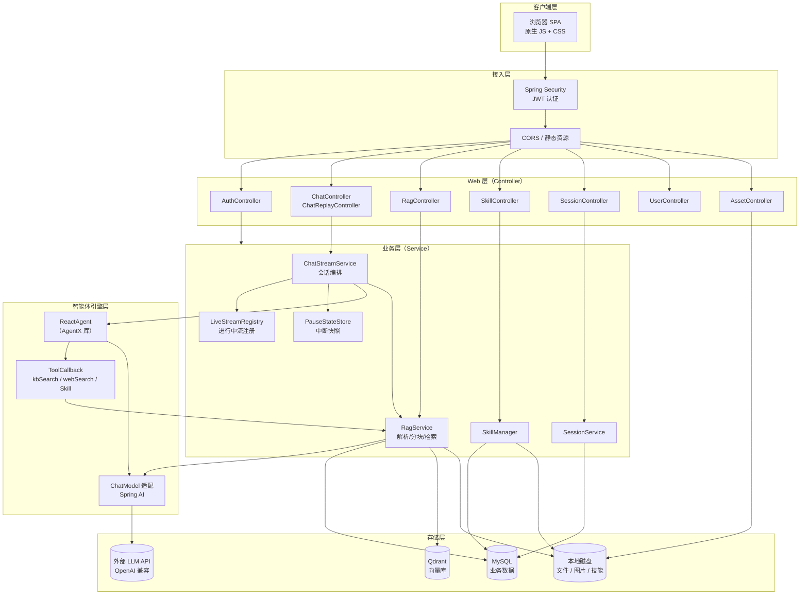
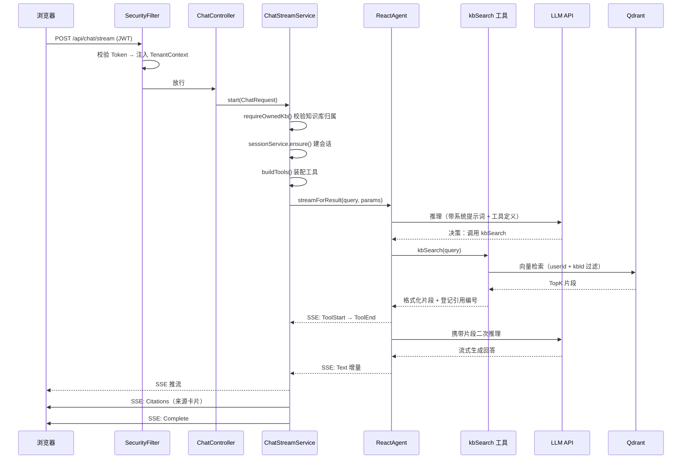
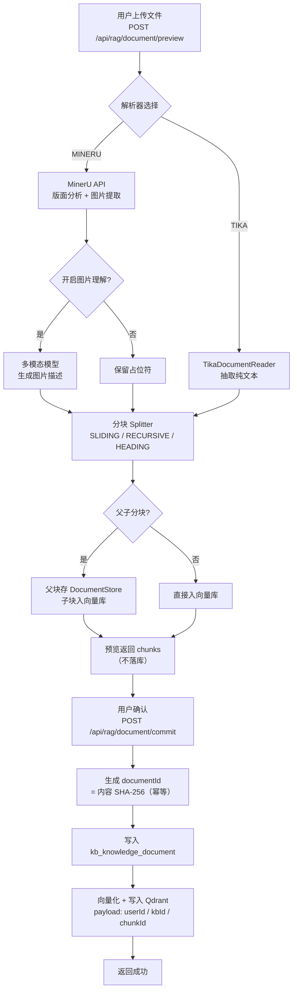
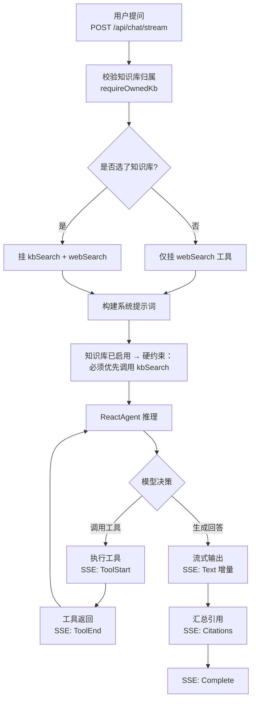
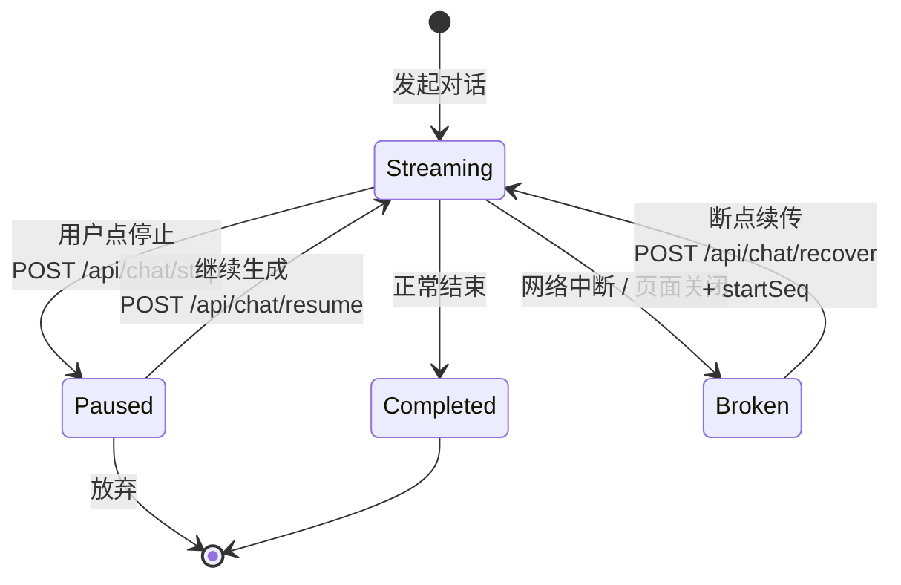
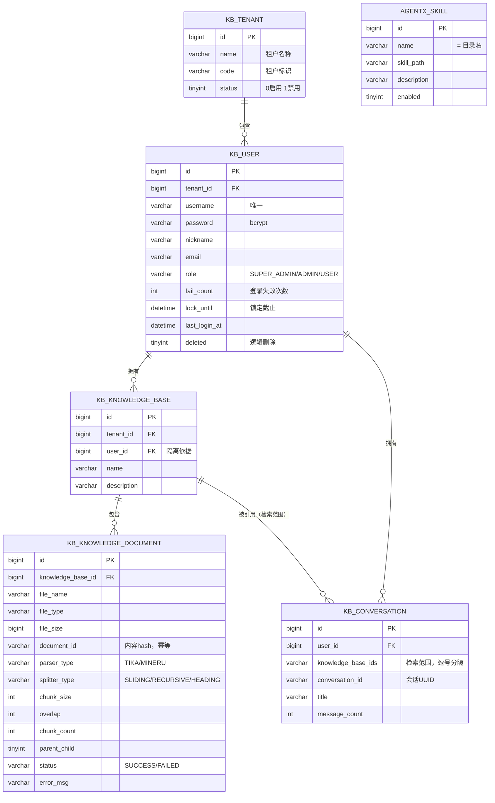
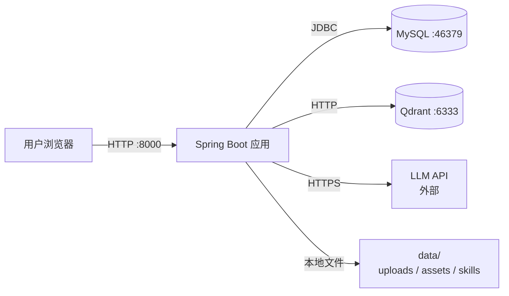

# 知微（ZhiWei）智能体平台 — 系统设计与实现报告

> 版本：1.0
> 日期：2026-11-24
> 项目路径：`personal-agentic-rag`
> 技术栈：Java 21 / Spring Boot 3.5.6 / Spring AI 1.1.0 / AgentX 1.0.1-M2

---

## 目录

1. [项目概述](#1-项目概述)
2. [系统架构](#2-系统架构)
3. [技术选型与理由](#3-技术选型与理由)
4. [核心流程设计](#4-核心流程设计)
5. [数据模型](#5-数据模型)
6. [接口设计](#6-接口设计)
7. [关键实现细节](#7-关键实现细节)
8. [部署方案](#8-部署方案)
9. [已实现功能清单](#9-已实现功能清单)
10. [已知限制与改进方向](#10-已知限制与改进方向)

---

## 1. 项目概述

### 1.1 背景

知微是一个**个人智能体平台**，目标是提供类 ChatGPT / Claude 的对话体验，并在此基础上叠加两类增强能力：

- **知识库检索增强（RAG）**：用户上传文档后，智能体可基于私有资料回答，并给出可溯源的引用标注
- **工具调用（ReAct）**：智能体自主决策调用工具（知识库检索、联网搜索、技能加载），过程对用户可见

区别于简单的「LLM 套壳」，本系统的核心价值在于**完整的检索链路**与**可观测的推理过程**。

### 1.2 设计目标

| 目标 | 具体要求 |
|---|---|
| 对话体验 | 流式输出，思考过程与工具调用可见、可折叠 |
| 检索质量 | 支持多解析器、多种分块策略、父文档扩展、重排序 |
| 多用户 | 知识库与会话严格按用户隔离 |
| 可部署 | 单机可运行，依赖组件最小化 |
| 可扩展 | 工具、技能可插拔 |

### 1.3 功能范围

**本期实现**：
- 用户认证（注册 / 登录 / JWT 会话）
- 多轮对话（流式、中断恢复、重新生成）
- 知识库（创建 / 文档上传 / 解析 / 向量化 / 检索）
- 技能管理（zip 包上传 / 启停）
- 图片资产（文档内图片提取、可访问 URL 回写）
- 管理后台（用户管理）

**不在本期范围**：多租户计费、对话分享、移动端、消息分支树。

---

## 2. 系统架构

### 2.1 分层架构图



### 2.2 模块职责

| 模块 | 包路径 | 职责 |
|---|---|---|
| `common` | `com.ziwei.zw.common` | 统一响应 `R<T>`、全局异常处理、健康检查 |
| `user` | `com.ziwei.zw.user` | 认证、JWT、用户管理 |
| `security` | `com.ziwei.zw.security` | Spring Security 配置、过滤器 |
| `stream` | `com.ziwei.zw.stream` | 对话流编排、SSE 事件、中断恢复 |
| `rag` | `com.ziwei.zw.rag` | 知识库、文档解析、向量检索、图片资产 |
| `skill` | `com.ziwei.zw.skill` | 技能包上传、启停、目录管理 |
| `session` | `com.ziwei.zw.session` | 会话列表、明细、删除 |
| `config` | `com.ziwei.zw.config` | 配置属性、智能体装配 |

### 2.3 请求处理主链路



---

## 3. 技术选型与理由

| 组件 | 选型 | 理由 |
|---|---|---|
| 语言 / 运行时 | Java 21 | 虚拟线程、Record、模式匹配；与 AgentX 库要求一致 |
| Web 框架 | Spring Boot 3.5.6 | 生态成熟，SSE / Security / 事务开箱可用 |
| 智能体引擎 | Spring AI 1.1.0 + AgentX 1.0.1-M2 | 提供 ReAct 循环、工具注册、流式回调、中断恢复 |
| 关系库 | MySQL 8 | 业务数据（用户 / 知识库 / 文档 / 会话 / 技能） |
| 向量库 | Qdrant | 单二进制部署、payload 过滤灵活、无需额外中间件 |
| 文档解析 | Apache Tika + MinerU | Tika 覆盖常见格式；MinerU 支持版面分析与图片理解 |
| 前端 | 原生 JS + CSS | 无构建步骤，便于课程演示与快速迭代 |
| 认证 | JWT (HS256) | 无状态，前端存储简单 |

### 3.1 为什么不用 LangChain4j

AgentX 是本项目合作方提供的库，已封装 ReAct 循环、流式事件模型、中断快照等能力。自研或换用其他框架会显著增加工作量，且难以保证事件语义（如 `Thinking` / `ToolStart` / `ToolEnd` 的时序）与前端渲染逻辑一致。

### 3.2 为什么向量库选 Qdrant 而非 PgVector

- Qdrant 单 exe 启动，无需 PostgreSQL 实例（部署机器内存仅 2 GB）
- payload filter 语法直观，支持 `userId` + `knowledgeBaseId` 组合过滤
- 本题场景数据量小（万级 chunk），性能不是瓶颈，部署简易性优先

---

## 4. 核心流程设计

### 4.1 文档入库流程（RAG 写链路）



**设计要点**

- **两阶段提交**：`preview` 只解析不落库，用户可在前端预览分块效果后再 `commit`，避免误上传浪费存储
- **幂等**：`documentId` 用内容 SHA-256，同内容重复上传不会产生重复向量
- **父子分块**：子块（小）用于精准检索，父块（大）用于提供上下文，检索命中子块后回查父块喂给模型

### 4.2 对话检索流程（RAG 读链路 + ReAct）



**关键设计：为什么不用服务端预检索**

早期版本在进模型前先跑一次检索，把片段直接塞进 prompt。这确实能保证「选了知识库就一定用上」，但带来两个问题：

1. 模型拿到答案后不再调用 `kbSearch`，前端收不到 `ToolStart` / `ToolEnd`，**工具调用过程在 UI 上完全消失**
2. 违背 ReAct 的语义——工具调用应由模型自主决策

最终改为**提示词硬约束**：在系统提示词中把知识库检索列为最高优先级，要求「第一步永远先调用 kbSearch，即使觉得是常识也要先检索」。模型自主发起检索，工具调用过程得以正常展示。

### 4.3 流式事件模型（SSE）

系统使用 Server-Sent Events 单向推送，事件类型共 8 种：

| 事件 | 触发时机 | 载荷 |
|---|---|---|
| `Thinking` | 模型思考过程 | `content`: 增量文本 |
| `ToolStart` | 工具调用开始 | `toolName`, `toolCallId`, `arguments` |
| `ToolEnd` | 工具调用结束 | `toolCallId`, `result` |
| `Text` | 正文增量 | `content`: 增量文本 |
| `Citations` | 正文结束后 | `items`: 引用数组 |
| `TodoProgress` | 待办进度更新 | `items`: 待办列表 |
| `Error` | 执行失败 | `message` |
| `Stopped` | 用户中断 | `message` |
| `Complete` | 流结束 | `conversationId` |

**引用对象 `Citation` 结构**：

```json
{
  "no": 1,
  "fileName": "产品手册.pdf",
  "headingPath": "第三章 > 安全机制",
  "chunkId": "9c34c8de-...",
  "documentId": "b8ed59af...",
  "text": "片段原文",
  "assetUrl": "/api/assets/{batchId}/images/xxx.jpg",
  "contentType": "text"
}
```

### 4.4 中断与恢复



- **中断快照**：`PauseStateStore` 保存已生成内容与轮次状态
- **事件序号**：每个 SSE 事件带 `seq`，前端记录 `lastSeq`，重连时带 `startSeq` 续传，避免重复渲染

---

## 5. 数据模型

### 5.1 ER 图



### 5.2 表设计说明

| 表 | 说明 | 关键设计 |
|---|---|---|
| `kb_tenant` | 租户 | 预留多租户能力，当前单租户 |
| `kb_user` | 用户 | 密码 bcrypt；含失败计数与锁定时间，防暴力破解 |
| `kb_knowledge_base` | 知识库 | `user_id` 是隔离依据，所有查询必须带此条件 |
| `kb_knowledge_document` | 文档元数据 | 记录解析与分块参数，便于复现；`document_id` 为内容 hash |
| `kb_conversation` | 会话 | `knowledge_base_ids` 存检索范围；会话独立于知识库存在 |
| `agentx_skill` | 技能 | **全局共享**（无 user_id），故增删改限管理员 |

### 5.3 向量库 payload 结构

Qdrant collection `ziwei_rag` 的 payload：

```json
{
  "chunkId": "9c34c8de-d78e-4aa7-b134-9401eabcdac9",
  "chunkGroupId": "1bfaea3c-...",
  "chunkIndex": 0,
  "chunkTotal": 1,
  "documentId": "b8ed59af...",
  "fileName": "产品手册.pdf",
  "userId": "1",
  "knowledgeBaseId": "2",
  "contentType": "text",
  "doc_content": "片段原文...",
  "containsImg": true,
  "imgUrls": ["file:///C:/ziwei/data/assets/{batchId}/images/xxx.jpg"],
  "createdAt": "2026-11-20 16:41:55"
}
```

**检索过滤条件**（必须同时满足）：

```
userId == 当前用户  AND  knowledgeBaseId IN (选中的库)
```

---

## 6. 接口设计

完整契约见 [`openapi.yaml`](./openapi.yaml)。以下为概览。

### 6.1 通用约定

**统一响应体**

```json
{ "code": 0, "msg": "ok", "data": {} }
```

- `code = 0` 表示成功，非 0 为业务错误码
- HTTP 状态码与 `code` 并存：`401` 未认证、`403` 无权限、`400` 参数错误

**认证**：除 `/api/auth/login`、`/api/auth/register`、`/api/health` 外，均需 `Authorization: Bearer <token>`

### 6.2 接口清单

| 分组 | 方法 | 路径 | 说明 |
|---|---|---|---|
| 认证 | POST | `/api/auth/login` | 登录 |
| | POST | `/api/auth/register` | 注册 |
| | POST | `/api/auth/logout` | 登出 |
| | GET | `/api/auth/me` | 当前用户 |
| 对话 | POST | `/api/chat/stream` | **发起对话（SSE）** |
| | POST | `/api/chat/attach` | 上传对话附件 |
| | GET | `/api/chat/models` | 模型档位列表 |
| | GET | `/api/chat/status` | 流状态查询 |
| | POST | `/api/chat/stop` | 中断 |
| | POST | `/api/chat/resume` | 继续生成（SSE） |
| | POST | `/api/chat/recover` | 断点续传（SSE） |
| | GET | `/api/chat/replay/{cid}` | 会话回放 |
| 知识库 | GET | `/api/rag/knowledge-base` | 列表 |
| | POST | `/api/rag/knowledge-base` | 创建 |
| | PUT | `/api/rag/knowledge-base/{id}` | 修改 |
| | DELETE | `/api/rag/knowledge-base/{id}` | 删除 |
| | GET | `/api/rag/knowledge-base/{id}/document` | 文档列表 |
| | POST | `/api/rag/document/preview` | **文档解析预览** |
| | POST | `/api/rag/document/commit` | **确认入库** |
| | DELETE | `/api/rag/document/{id}` | 删除文档 |
| | POST | `/api/rag/knowledge-base/{id}/chat/stream` | 限定单库对话（SSE） |
| 会话 | GET | `/api/sessions` | 列表（分页） |
| | GET | `/api/sessions/{cid}` | 明细 |
| | DELETE | `/api/sessions/{cid}` | 删除 |
| 技能 | GET | `/api/skills` | 列表 |
| | POST | `/api/skills/upload` | 上传 zip（管理员） |
| | PUT | `/api/skills/{name}/enabled` | 启停（管理员） |
| | DELETE | `/api/skills/{name}` | 删除（管理员） |
| 用户 | GET | `/api/admin/user` | 用户列表（管理员） |
| | POST | `/api/admin/user` | 创建（管理员） |
| | PUT | `/api/admin/user/{id}` | 修改（管理员） |
| | DELETE | `/api/admin/user/{id}` | 删除（管理员） |
| 资产 | GET | `/api/assets/**` | 图片资产 |
| 健康 | GET | `/api/health` | 探针 |

### 6.3 SSE 接口说明

`/api/chat/stream` 返回 `text/event-stream`，每帧格式：

```
id: 1
data: {"type":"Thinking","content":"用户"}

id: 2
data: {"type":"Text","content":"RAG 是"}
```

事件类型详见 [4.3 节](#43-流式事件模型sse)。

---

## 7. 关键实现细节

### 7.1 用户隔离（三层防护）

| 层 | 实现 |
|---|---|
| 列表查询 | `LambdaQueryWrapper.eq(KnowledgeBase::getUserId, TenantContext.requireUserId())` |
| 单条操作 | `requireOwnedKb(id)` 校验归属，不匹配抛 403 |
| 向量检索 | filter expression 强制带 `userId` 条件 |

**验证结果**（实测）：

```
test 用户（id=2）看到的知识库：[3, 4]      ← 只有自己的
test 访问 admin 的库 2 → 403 无权操作该知识库
```

### 7.2 图片资产链路

MinerU 解析 PDF 时会抽取内嵌图片，落盘到 `{assetDir}/{batchId}/images/{hash}.jpg`，并在 Markdown 中写入引用：

```

```

**问题**：`file:///` 是宿主机路径，浏览器无法访问。

**解决**：在返回 `Citation` 前把路径改写为可访问的 HTTP 地址：

```java
// 片段原文中的图片引用
text.replaceAll("file:///[A-Za-z]:[^)\"'\\s]*?/assets/([^)\"'\\s]+)", "/api/assets/$1")
```

`AssetController` 按 `{batchId}/images/{文件名}` 或纯文件名反查，返回图片流。

**同时**在 `Citation` 中新增 `assetUrl` 与 `contentType` 字段，前端可直接渲染 ``，无需解析 Markdown。

### 7.3 技能包解析（编码与 BOM 兼容）

上传 zip 时遇到两个 Windows 特有的坑：

| 问题 | 现象 | 解决 |
|---|---|---|
| **GBK 文件名** | `malformed input off : 58, length : 1` | 先探测编码：UTF-8 能完整读完就用 UTF-8，否则退回 GBK |
| **UTF-8 BOM** | 技能名变成 `zw-skill-1234567`，描述为空 | 解析 frontmatter 前 `content.replace("\uFEFF", "")` |

```java
private Charset detectZipCharset(byte[] all) {
    try (ZipInputStream zis = new ZipInputStream(new ByteArrayInputStream(all), UTF_8)) {
        while (zis.getNextEntry() != null) zis.closeEntry();
        return StandardCharsets.UTF_8;
    } catch (Exception e) {
        return Charset.forName("GBK");   // Windows 压缩工具的默认编码
    }
}
```

### 7.4 输入框滚动跟随

流式输出时，若每个 token 都执行 `scrollTop = scrollHeight`，用户向上翻看历史会被立刻拽回底部。

**解决**：引入「是否贴底」判断，只在用户本来就在底部时跟随：

```javascript
function isNearBottom() {
  const sc = $('scroll');
  return sc.scrollHeight - sc.scrollTop - sc.clientHeight < 80;   // 80px 容差
}

function scrollToBottom(force) {
  if (!force && !isNearBottom()) return;   // 用户翻上去了就不跟随
  sc.scrollTop = sc.scrollHeight;
}
```

同时区分场景：打开会话、发送新消息时 `force = true`；流式增量时不 force。

---

## 8. 部署方案

### 8.1 依赖组件

| 组件 | 版本 | 端口 | 必需 |
|---|---|---|---|
| JDK | 21 | — | ✅ |
| MySQL | 8.x | 46379 | ✅ |
| Qdrant | 1.x | 6333 / 6334 | ✅ |
| 外部 LLM API | OpenAI 兼容 | 443 | ✅ |
| MinerU API | — | 443 | 可选（仅图片/PDF 解析） |

### 8.2 部署拓扑



### 8.3 启动步骤

```bash
# 1. 建库
mysql -u root -p < src/main/resources/db/schema-mysql.sql

# 2. 启动 Qdrant
qdrant.exe    # 默认监听 6333/6334

# 3. 配置（application-local.yml）
#    - 数据库连接
#    - Qdrant 地址与 api-key
#    - LLM base-url / api-key / model

# 4. 启动应用
java -jar zw-agent-platform-0.1.0.jar \
     --server.port=8000 \
     --spring.profiles.active=local
```

### 8.4 资源占用（实测）

| 进程 | 内存 |
|---|---|
| Java 应用 | ~270 MB |
| MySQL | ~50 MB |
| Qdrant | ~80 MB |
| 系统 + 其他 | ~1.3 GB |

**合计约 1.7 GB / 2 GB**，可运行但余量不大。

---

## 9. 已实现功能清单

### 9.1 对话

- ✅ 流式输出（SSE，逐 token 推送）
- ✅ 思考过程展示与折叠
- ✅ 工具调用过程展示（图标 + 中文动作 + 入参 + 结果折叠）
- ✅ 来源引用卡片（含图片渲染）
- ✅ 中断（停止生成）
- ✅ 继续生成（中断快照恢复）
- ✅ 断点续传（网络中断后按事件序号续传）
- ✅ 会话回放
- ✅ 重新生成
- ✅ 复制消息
- ✅ 向上翻看历史时不被强制拉回底部

### 9.2 知识库

- ✅ 多知识库管理与切换
- ✅ 双解析器（Tika / MinerU）
- ✅ 三种分块策略（滑动 / 递归 / 标题层级）
- ✅ 父子分块
- ✅ 文档预览后再入库（两阶段提交）
- ✅ 图片提取 + 图片理解（多模态模型生成描述）
- ✅ 向量检索 + 可选重排序
- ✅ 引用编号与来源标注

### 9.3 系统

- ✅ JWT 认证 + 登录失败锁定
- ✅ 角色权限（SUPER_ADMIN / ADMIN / USER）
- ✅ 用户数据隔离（知识库 / 会话 / 向量检索）
- ✅ 技能管理（zip 上传 / 启停 / 删除）
- ✅ 深色 / 浅色主题切换
- ✅ 模型档位选择

---

## 10. 已知限制与改进方向

### 10.1 已知限制

| 项 | 说明 |
|---|---|
| 会话未分页加载完整 | 侧栏固定拉取 30 条，超出部分不可见 |
| 会话不可重命名 | 后端无 `PUT` 接口，前端无入口 |
| 无 SSE 心跳 | 长思考时连接可能被中间层掐断 |
| 附件无缩略图 | 图片附件只显示文件名 |
| 技能全局共享 | 无用户隔离，故仅管理员可操作 |
| 单机部署 | 无水平扩展能力，Qdrant 与应用未容器编排 |

### 10.2 改进方向

**短期（体验）**
1. 会话重命名 + 删除（右键菜单）
2. 会话按时间分组（今天 / 昨天 / 前 7 天）
3. 空状态示例问题卡片
4. SSE 心跳（每 15s 发注释帧保活）
5. 附件缩略图预览

**中期（能力）**
1. 检索质量评估（召回率 / 精确率基线测试集）
2. 混合检索（向量 + 关键词 BM25 加权融合）
3. 查询改写与多查询扩展
4. 文档增量更新（当前为全量重建）

**长期（架构）**
1. 容器化编排（Docker Compose / K8s）
2. 向量库分片与副本
3. 对话分享（只读链接 + 权限控制）
4. 消息分支树（Claude 式重新生成保留历史）

---

## 附录 A：包结构

```
src/main/java/com/ziwei/zw/
├── ZwApplication.java
├── common/          统一响应、异常、健康检查
├── config/          配置属性、智能体装配
├── security/        Spring Security、JWT 过滤器
├── user/            认证、用户管理
│   ├── controller/
│   ├── domain/
│   ├── dto/
│   └── service/
├── stream/          对话编排、SSE
│   ├── ChatController.java
│   ├── ChatStreamService.java
│   ├── ChatReplayController.java
│   ├── LiveStreamRegistry.java
│   ├── PauseStateStore.java
│   └── dto/
├── rag/             知识库、检索
│   ├── controller/
│   ├── domain/
│   ├── dto/
│   ├── service/
│   └── tool/        KbSearchTool、WebSearchTool、Citation
├── skill/           技能管理
└── session/         会话管理
```

## 附录 B：配置项说明

| 配置键 | 说明 | 示例 |
|---|---|---|
| `spring.datasource.*` | MySQL 连接 | `jdbc:mysql://localhost:46379/ziwei` |
| `zw.rag.qdrant.host` | Qdrant 地址 | `127.0.0.1` |
| `zw.rag.qdrant.api-key` | Qdrant 密钥 | `zw-qd-xxx` |
| `zw.rag.qdrant.collection` | 集合名 | `ziwei_rag` |
| `zw.model.chat.base-url` | LLM 接口地址 | `https://xxx/compatible-mode/v1` |
| `zw.model.chat.api-key` | LLM 密钥 | `sk-xxx` |
| `zw.model.chat.model` | 模型名 | `qwen3.7-flash` |
| `zw.agent.skills-dir` | 技能目录 | `./data/skills` |
| `zw.rag.mineru.token` | MinerU token | — |
| `zw.rag.mineru.asset-dir` | 图片资产目录 | `./data/assets` |

---

*报告结束*
