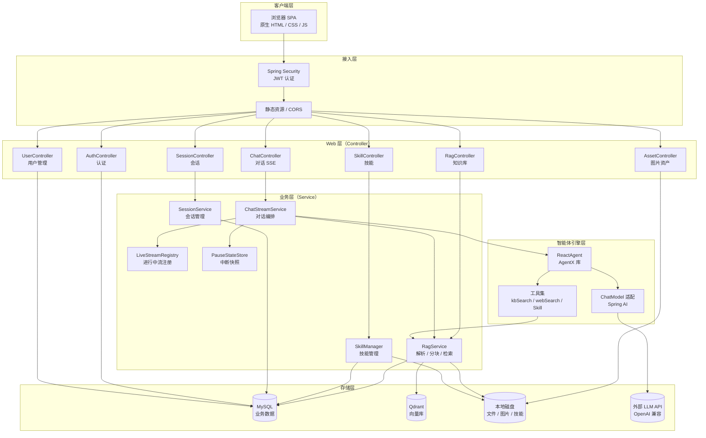
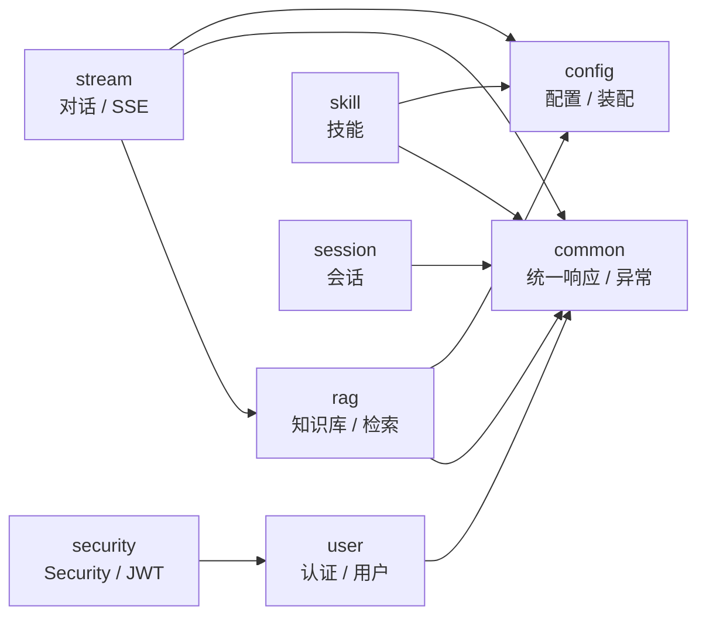
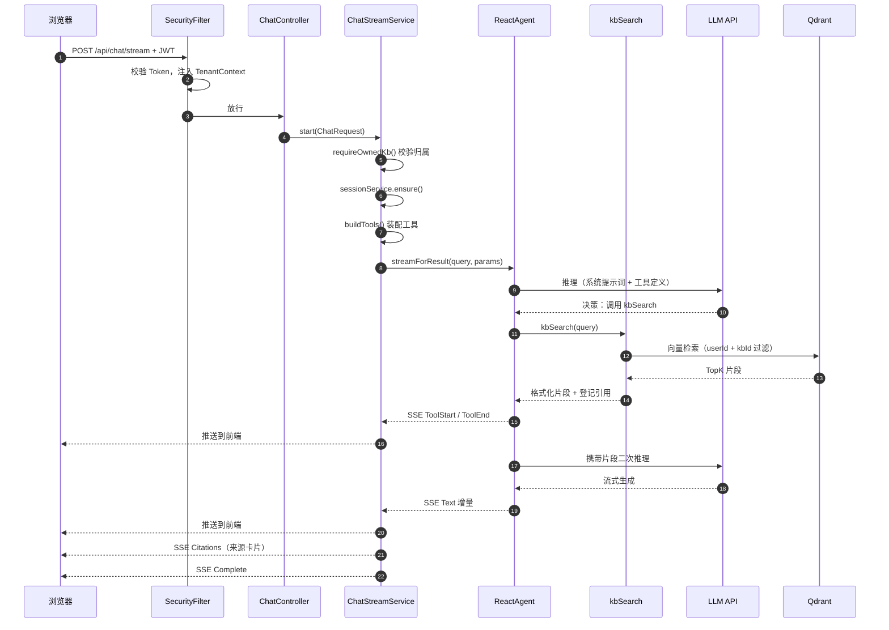
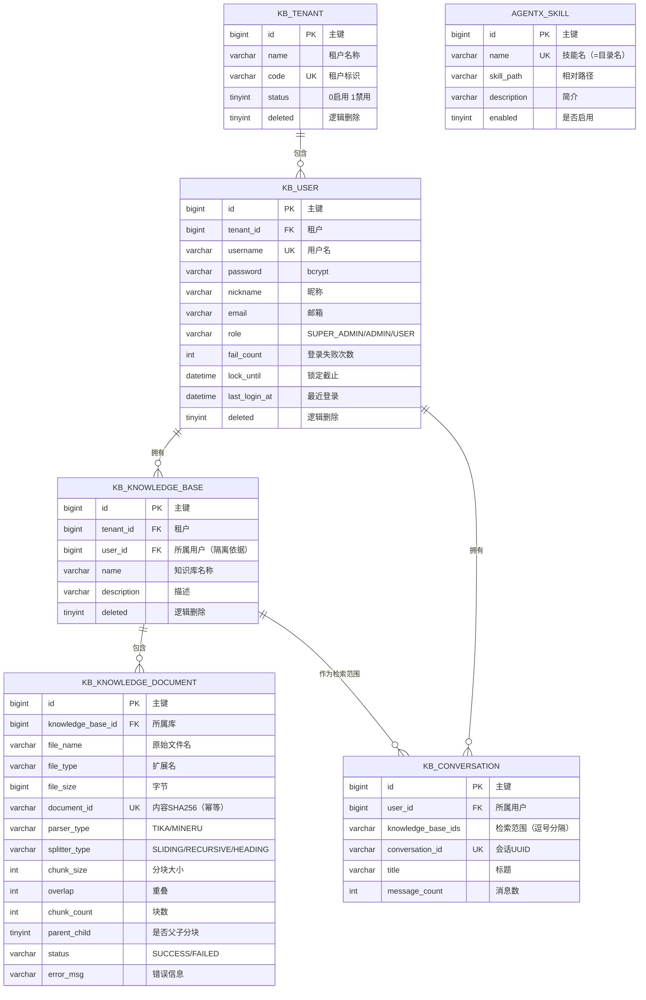
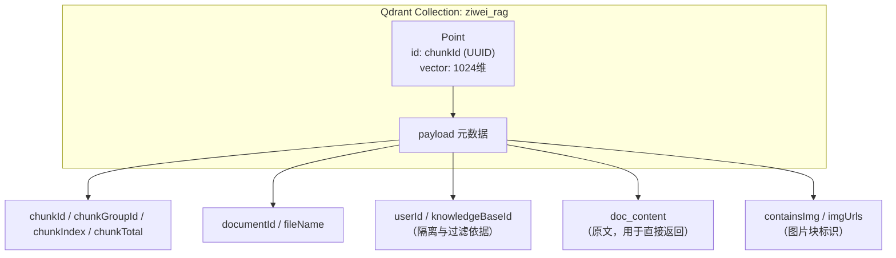
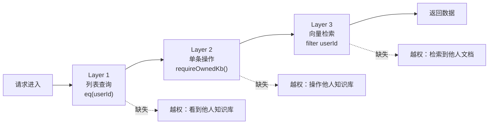
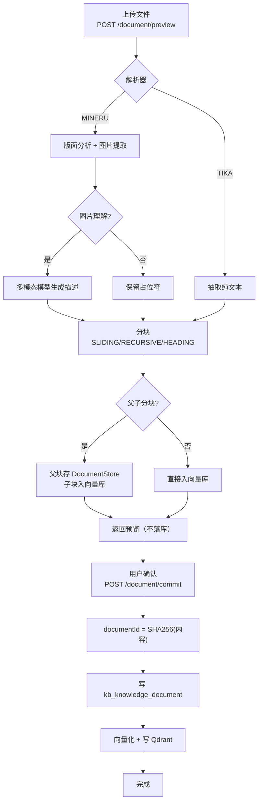
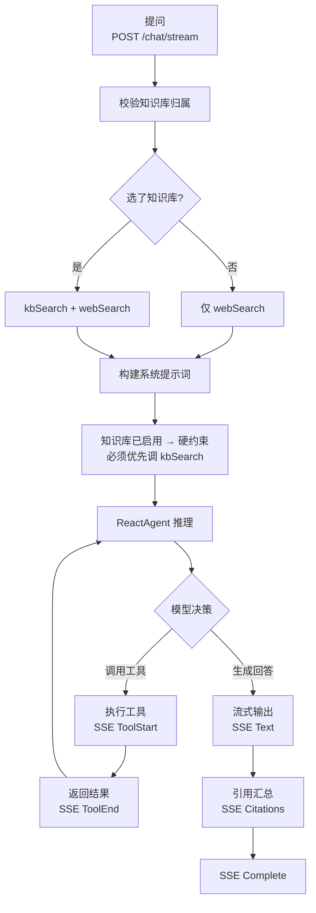
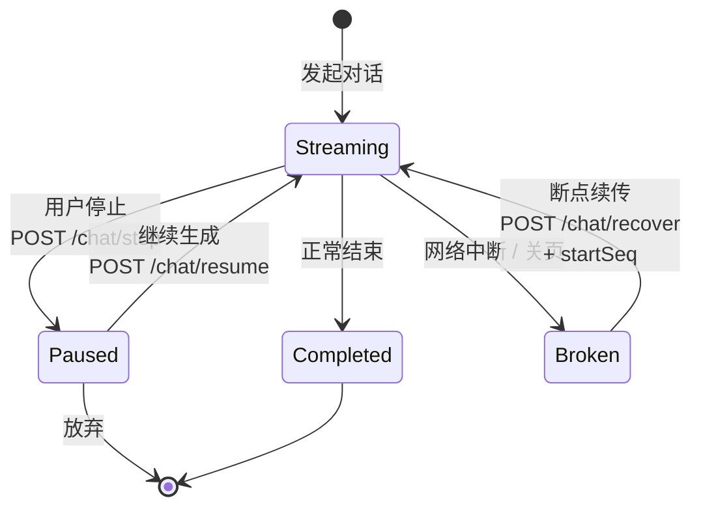
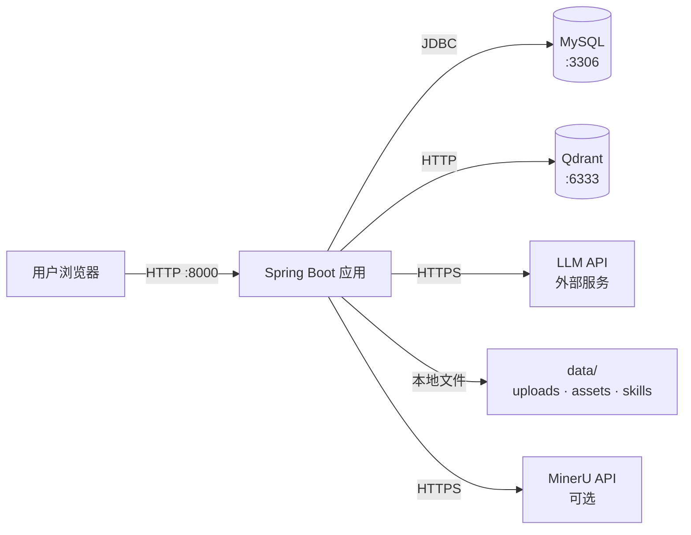

# 系统结构图与数据模型图

> 本文件收录知微平台的系统架构图与数据模型图。
> 图形使用 Mermaid 语法，GitHub / GitLab / 语雀 / 飞书均可直接渲染。

---

## 一、系统架构

### 1.1 分层架构



### 1.2 模块依赖关系



### 1.3 请求主链路时序



---

## 二、数据模型

### 2.1 ER 图



### 2.2 向量库结构（Qdrant）

不使用关系表，使用 collection `ziwei_rag`，每个点代表一个文本块：



**检索过滤条件**（必须同时满足）：

```
userId == 当前用户  AND  knowledgeBaseId IN (选中的知识库)
```

### 2.3 表间关系说明

| 关系 | 说明 |
|---|---|
| 租户 → 用户 | 1:N，当前实现为单租户，保留多租户扩展点 |
| 用户 → 知识库 | 1:N，**`user_id` 是所有查询的强制过滤条件** |
| 用户 → 会话 | 1:N，会话独立于知识库存在 |
| 知识库 → 文档 | 1:N，删除知识库时级联清理文档与向量 |
| 知识库 ↔ 会话 | N:M（通过 `kb_conversation.knowledge_base_ids` 逗号串），一条会话可跨多库检索 |
| 技能 | **无用户归属**，全平台共享，故增删改仅限管理员 |

### 2.4 隔离机制（三层防护）



---

## 三、核心流程图

### 3.1 文档入库（写链路）



### 3.2 对话检索（读链路 + ReAct）



### 3.3 中断与恢复状态机



---

## 四、部署拓扑



**资源占用参考**（实测，2 GB 内存单机）：

| 进程 | 内存 |
|---|---|
| Java 应用 | ~270 MB |
| MySQL | ~50 MB |
| Qdrant | ~80 MB |
| 系统 + 其他 | ~1.3 GB |
